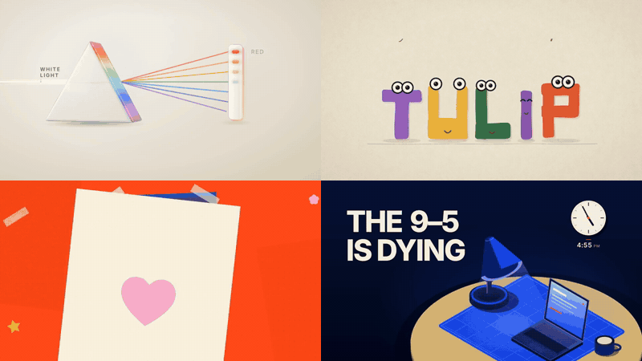

# Motion Graphics Skills for AI Coding Agents

> **56 open-source skills that teach your AI coding agent to make motion graphics, animation, and video** — kinetic typography, data-driven charts, explainers, TikTok / Reels, 3D & WebGL, math animation, generative illustration, code-drawn canvas animation, transparent lower thirds, b-roll for talking-head videos, AI presenter films, and web motion. Nineteen installable packs. Install one, and your agent just knows how.


Motion is the hardest thing to get right from a prompt: timing and easing, safe areas, frame-accurate rendering, on-brand type and color, a loop that actually loops. These skills encode that craft as agent-native workflows — each one teaches the agent *how a professional would build it*, with a **deliver-and-verify loop** (render a frame → screenshot → check) so it inspects its own output instead of hoping.

They're the open-source craft behind **[iart.ai](https://www.iart.ai/?utm_source=github&utm_medium=readme&utm_campaign=motion-skills&utm_content=intro)**, the AI motion agent. Bring them into the agent you already use — or let iart.ai run the whole pipeline for you.

## The 19 packs

Each pack is its own repo, aimed at one audience. Install only what you need.

| Pack | For | Skills |
|---|---|---|
| **[tiktok-video-skills](https://github.com/iart-ai/tiktok-video-skills)** | TikTok / Reels / Shorts creators | 4 |
| **[text-message-video-skills](https://github.com/iart-ai/text-message-video-skills)** | Text-message story creators | 1 |
| **[youtube-video-skills](https://github.com/iart-ai/youtube-video-skills)** | Podcasters & YouTubers | 2 |
| **[ecommerce-video-skills](https://github.com/iart-ai/ecommerce-video-skills)** | E-commerce sellers | 3 |
| **[ad-video-skills](https://github.com/iart-ai/ad-video-skills)** | Brand advertisers & marketers | 3 |
| **[data-animation-skills](https://github.com/iart-ai/data-animation-skills)** | Analysts & PMs | 3 |
| **[explainer-video-skills](https://github.com/iart-ai/explainer-video-skills)** | Educators & content creators | 5 |
| **[map-animation-skills](https://github.com/iart-ai/map-animation-skills)** | Vox-style editorial maps | 1 |
| **[web-animation-skills](https://github.com/iart-ai/web-animation-skills)** | Frontend developers | 9 |
| **[motion-design-skills](https://github.com/iart-ai/motion-design-skills)** | Motion designers | 9 |
| **[kinetic-typography-skills](https://github.com/iart-ai/kinetic-typography-skills)** | Kinetic type / text animation | 1 |
| **[freelance-motion-skills](https://github.com/iart-ai/freelance-motion-skills)** | Freelancers & studios | 5 |
| **[webgl-animation-skills](https://github.com/iart-ai/webgl-animation-skills)** | 3D / WebGL / technical | 3 |
| **[manim-skills](https://github.com/iart-ai/manim-skills)** | Math / educational animators | 1 |
| **[generative-illustration-skills](https://github.com/iart-ai/generative-illustration-skills)** | Generative-illustration & creative coders | 1 |
| **[javascript-animation-skills](https://github.com/iart-ai/javascript-animation-skills)** | Every frame drawn in JavaScript: zero-asset canvas films + code-made music | 2 |
| **[lower-thirds-skills](https://github.com/iart-ai/lower-thirds-skills)** | Streamers, podcasters & editors: transparent lower thirds for OBS, Premiere, Resolve | 1 |
| **[b-roll-skills](https://github.com/iart-ai/b-roll-skills)** | YouTubers, course creators & editors: b-roll motion graphics for talking-head videos, drawn from what is said | 1 |
| **[talking-head-skills](https://github.com/iart-ai/talking-head-skills)** | Creators & educators: generate talking-head footage from photos and a voice, then combine it with narration and motion graphics | 1 |

Browse every pack and skill, with install commands, at **[iart.ai/skills](https://www.iart.ai/skills?utm_source=github&utm_medium=readme&utm_campaign=motion-skills&utm_content=packs)**.

## Install

Each pack installs on its own:

```bash
npx skills add iart-ai/tiktok-video-skills
npx skills add iart-ai/data-animation-skills
# …or any pack above
```

Or add one as a Claude Code plugin:

```bash
/plugin marketplace add iart-ai/web-animation-skills
```

Once installed, skills are auto-discovered by Claude Code, Cursor, Codex, and 40+ agents — and activate on their own when your prompt matches the work.

## Or let iArt run it



*Made in iArt with DeepSeek, each from a one-line prompt.*

These skills are the craft inside **[iArt](https://www.iart.ai/?utm_source=github&utm_medium=readme&utm_campaign=motion-skills&utm_content=run-it)**, the strongest DeepSeek animation agent and the cheapest Claude animation agent. On Claude, prebuilt scaffolding, context design and tool design reach the same quality at about **1/5 of the cost** of running the model yourself (average of 10,000+ ablation runs on Claude). Made for the latest models: DeepSeek 4.1, Claude Fable 5.2, Opus 5.5, Sonnet 5.5, Haiku 5.5 and Gemini 4 Argon. Voiceover, image generation and AI video come out of the same credit. [See pricing →](https://www.iart.ai/pricing?utm_source=github&utm_medium=readme&utm_campaign=motion-skills&utm_content=run-it)

## What's a skill?

A skill is a self-contained folder (`SKILL.md` + `references/`) that teaches an agent one motion-graphics workflow — kinetic typography, beat-synced cuts, frame-accurate data charts, accessible web animation, and so on. No model fine-tuning, no plugin runtime: just the know-how, in a format every major agent already reads.

Skills that produce a visual artifact ship a **deliver-and-verify loop** plus a small `scripts/` toolkit (freeze a frame, tile a contact sheet, probe the encoded MP4), so the agent confirms its own output — web skills render a standalone HTML, video skills render via Remotion or Manim.

## Built for every kind of motion

Short-form vertical video • explainer and educational clips • data-driven infographics and charts • product and e-commerce demos • brand and ad creative • kinetic typography and titles • editorial map animation • logo and brand-system motion • GSAP / SVG / Lottie web animation • Three.js / WebGL / shaders • Manim math animation • Remotion programmatic video • zero-asset canvas animation drawn frame by frame in JavaScript • transparent lower thirds and stream overlays (WebM alpha, ProRes 4444) • b-roll for talking-head videos, timed to the words.

## License

MIT — use them freely.

---

Built by **[iart.ai](https://www.iart.ai/?utm_source=github&utm_medium=readme&utm_campaign=motion-skills&utm_content=footer)**, the AI motion agent — describe it in a prompt, or point it at a CSV or brand kit, and get editable, on-brand motion graphics with exact text and numbers.
